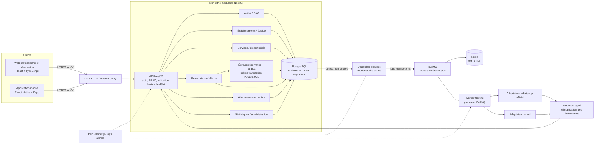
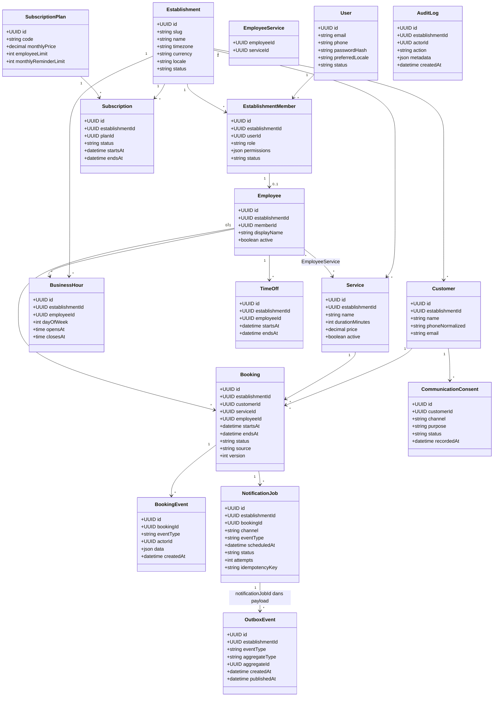

# Spécification technique — Rendez-vous

**Version :** 1.0  
**Date :** 28 octobre 2026  
**Statut :** Base de conception proposée pour le MVP  
**Marché :** Tunisie — français et arabe (RTL)  
**Périmètre :** SaaS multi-établissement, réservation Web/mobile, espace professionnel, calendrier, clients, notifications et administration de base.

> Cette spécification transforme le cahier des charges produit en base d’architecture. Les données d’exemple et métriques du prototype ne sont pas des données métier réelles. Les règles juridiques, le fournisseur WhatsApp, l’hébergement et le paiement d’abonnement restent à valider avant la production.

## 1. Décisions techniques

| Domaine | Choix MVP |
|---|---|
| API | NestJS + TypeScript, REST versionnée sous `/api/v1` |
| Runtime | Version LTS de Node.js supportée au démarrage |
| Base de données | PostgreSQL, UUID, migrations versionnées |
| Accès aux données | Prisma ORM et Prisma Migrate pour le schéma et les migrations usuelles ; SQL de migration explicite pour les extensions et contraintes PostgreSQL spécifiques (notamment `btree_gist` et l’exclusion de chevauchement). Requêtes brutes uniquement paramétrées. |
| Authentification | JWT + Passport (`@nestjs/passport`, stratégie JWT) pour les professionnels ; access token court gardé en mémoire dans le Web, refresh token rotatif révocable dans un cookie `HttpOnly`, `Secure` en production, `SameSite=Lax`. Les clients n’ont pas à créer de compte ; leur jeton limité à une réservation est aléatoire, à durée limitée et stocké sous forme hachée. |
| Web professionnel et réservation publique | React + TypeScript + Vite, réutilisation progressive du prototype |
| Application mobile | React Native + Expo + TypeScript, mêmes API et règles métier |
| Tâches asynchrones | Redis + BullMQ (`@nestjs/bullmq`) pour les files, rappels différés, reprises et workers. Outbox PostgreSQL transactionnelle comme relais fiable entre réservation et enfilement Redis. |
| Notifications | Adaptateurs e-mail / WhatsApp Business Platform ou fournisseur officiellement autorisé. Aucun envoi via WhatsApp Web automatisé. |
| Documentation API | Swagger / OpenAPI généré depuis les contrôleurs et DTO NestJS (`@nestjs/swagger`) |
| Validation | `class-validator`/`class-transformer` sur les DTO NestJS ; validation métier dans les services de domaine |
| Tests | Jest pour tests unitaires/intégration ; Supertest pour tests HTTP e2e NestJS avec PostgreSQL de test isolé |
| Observabilité | Logs structurés avec identifiant de corrélation, métriques et traces OpenTelemetry |
| Environnement reproductible | Docker et Docker Compose pour API, worker, PostgreSQL, Redis et outils locaux ; environnements development/test/staging/production séparés |

### Organisation NestJS suggérée

```text
src/
  app.module.ts
  common/                 # guards, décorateurs, filtres, pipes, pagination, erreurs
  config/                 # configuration typée et validation au démarrage
  database/               # Prisma, transactions, migrations
  auth/                   # Passport, stratégie JWT, sessions, refresh tokens
  swagger/                # DTO, tags, schémas et configuration OpenAPI
  establishments/         # tenants, profil public, paramètres métier
  memberships/             # rôles et permissions des utilisateurs professionnels
  employees/               # employés, services autorisés, horaires, indisponibilités
  services/                # catalogue et tarifs des prestations
  availability/            # calcul des créneaux, règles de temps et disponibilités
  bookings/                # réservation, modification, annulation et historique
  customers/               # profils clients isolés par établissement
  notifications/           # consentements, outbox, BullMQ, processors et adaptateurs
  queues/                   # configuration BullMQ, options communes et observabilité
  subscriptions/           # plans, abonnements et quotas
  reporting/               # statistiques calculées sur les données métier
  administration/          # opérations plateforme avec audit
  audit/                   # journal des opérations sensibles
  health/                  # readiness/liveness et dépendances
  test/                    # factories, fixtures et utilitaires e2e
```

Les contrôleurs traduisent HTTP en commandes/requêtes de cas d’usage ; ils ne portent ni règles de disponibilité ni logique transactionnelle. Le module `bookings` est l’unique chemin d’écriture des réservations, y compris pour les réservations créées par un professionnel.

### Dépendances d’infrastructure suggérées

```text
@nestjs/config             configuration et validation au démarrage
@nestjs/passport passport  stratégie JWT et guards d’authentification
@nestjs/jwt                signature et vérification des access tokens
@nestjs/swagger             génération OpenAPI
@nestjs/bullmq + bullmq     queues, workers et tâches différées
prisma + @prisma/client     accès PostgreSQL et migrations
class-validator             validation des DTO
jest + supertest            tests unitaires et HTTP e2e
```

Les versions seront alignées sur les versions LTS et compatibles disponibles au démarrage du développement, verrouillées par le lockfile et mises à jour par CI.

### Files BullMQ proposées

| File | Jobs | Politique |
|---|---|---|
| `booking-notifications` | Confirmation, rappels différés, modification et annulation | `jobId` déterministe basé sur l’ID `notification_jobs`, `attempts` borné, backoff exponentiel avec jitter, événements d’échec surveillés |
| `platform-tasks` | Nettoyage des clés d’idempotence, réconciliation outbox/queues et tâches d’exploitation | Jobs planifiés idempotents, concurrence limitée, aucune opération métier non traçable |

Le payload BullMQ contient principalement `notificationJobId` et un identifiant de corrélation. Le worker recharge depuis PostgreSQL l’état courant de la réservation, le consentement, le canal, la locale et le destinataire ; il ne fait pas confiance à une ancienne copie de données personnelles dans Redis. Un rappel calculé à une heure déjà dépassée est ignoré ou marqué `CANCELLED` selon l’événement, et non envoyé immédiatement sans règle métier explicite.

Lors d’une annulation, les jobs retardés connus sont supprimés de BullMQ si possible, puis `notification_jobs` est marqué `CANCELLED` dans la transaction métier. Le worker vérifie toujours l’état en base avant l’envoi : une suppression de queue qui arrive trop tard ne doit pas envoyer un rappel d’un rendez-vous annulé.

## 2. Diagramme d’architecture



### Principes d’exploitation et de fiabilité

- L’API, le dispatcher d’outbox et le worker BullMQ sont des processus déployables du même code NestJS ; les règles métier ne sont pas dupliquées.
- La réservation, les lignes `notification_jobs` et les événements `outbox_events` sont validés dans une même transaction PostgreSQL. Le dispatcher publie ensuite un job BullMQ dont le `jobId` est déterministe (UUID avec tirets remplacés, sans `:`) à partir de la notification.
- Le dispatcher prend une lease d’outbox avec `FOR UPDATE SKIP LOCKED`, publie avec `queue.add()`, puis renseigne `published_at` après l’acquittement Redis. Si le dispatcher tombe après publication et avant la mise à jour PostgreSQL, la lease expire et la republication réutilise le même `jobId`.
- BullMQ traite les délais (rappels 24 h et 2 h), les reprises avec backoff exponentiel et jitter, et la limitation de concurrence. Les appels fournisseur ne s’exécutent jamais dans une transaction PostgreSQL.
- Les jobs et callbacks sont idempotents dans la base métier. Les jobs terminés/échoués sont conservés assez longtemps pour dédupliquer une reprise de l’outbox. Un processus de réconciliation compare les notifications dues/en attente en PostgreSQL à l’état BullMQ et republie celles absentes après incident Redis. BullMQ garantit une livraison au moins une fois, pas une exécution exactement une fois ; le résultat incertain d’un envoi n’est jamais transformé en succès fictif.
- Les webhooks vérifient la signature du fournisseur sur le corps brut, enregistrent un identifiant fournisseur unique et sont traités de manière idempotente.
- Redis est configuré avec une politique de persistance adaptée (AOF et sauvegardes selon l’hébergement), des limites mémoire et une politique d’éviction qui ne supprime pas les clés de queue. La surveillance couvre profondeur, âge des jobs, jobs échoués, mémoire et disponibilité Redis.

## 3. Modèle de domaine et diagramme de classes

`Establishment` est le tenant. Les membres professionnels appartiennent à un tenant via `EstablishmentMember`; un profil `Employee` correspond à un membre pouvant fournir des prestations. Un client est créé dans le contexte d’un établissement, sans compte transversal obligatoire.



## 4. Schéma PostgreSQL de référence

Le SQL ci-dessous est une base de migration à adapter aux conventions du projet. Les identifiants sont générés par l’application. Les heures de rendez-vous sont des instants `timestamptz` stockés en UTC ; les horaires récurrents sont des heures locales interprétées avec `establishments.timezone` (identifiant IANA, par exemple `Africa/Tunis`). Le prix TND accepte trois décimales (millimes).

### 4.1. Tables principales

```sql
CREATE EXTENSION IF NOT EXISTS btree_gist;

CREATE TABLE users (
  id uuid PRIMARY KEY,
  email text,
  phone_normalized text,
  password_hash text NOT NULL,
  preferred_locale text NOT NULL DEFAULT 'fr'
    CHECK (preferred_locale IN ('fr', 'ar')),
  status text NOT NULL DEFAULT 'ACTIVE'
    CHECK (status IN ('ACTIVE', 'INVITED', 'DISABLED')),
  created_at timestamptz NOT NULL DEFAULT now(),
  updated_at timestamptz NOT NULL DEFAULT now(),
  CHECK (email IS NOT NULL OR phone_normalized IS NOT NULL)
);
CREATE UNIQUE INDEX ux_users_email_ci ON users (lower(email)) WHERE email IS NOT NULL;
CREATE UNIQUE INDEX ux_users_phone ON users (phone_normalized) WHERE phone_normalized IS NOT NULL;

CREATE TABLE auth_sessions (
  id uuid PRIMARY KEY,
  user_id uuid NOT NULL REFERENCES users(id),
  refresh_token_hash bytea NOT NULL UNIQUE,
  family_id uuid NOT NULL,
  expires_at timestamptz NOT NULL,
  rotated_at timestamptz,
  revoked_at timestamptz,
  created_at timestamptz NOT NULL DEFAULT now(),
  last_used_at timestamptz
);
CREATE INDEX ix_auth_sessions_user ON auth_sessions(user_id, expires_at DESC);
CREATE INDEX ix_auth_sessions_family ON auth_sessions(family_id);

CREATE TABLE establishments (
  id uuid PRIMARY KEY,
  slug text NOT NULL UNIQUE,
  name text NOT NULL,
  description text,
  address text,
  timezone text NOT NULL DEFAULT 'Africa/Tunis',
  currency char(3) NOT NULL DEFAULT 'TND',
  locale text NOT NULL DEFAULT 'fr' CHECK (locale IN ('fr', 'ar')),
  minimum_booking_notice_minutes integer NOT NULL DEFAULT 60
    CHECK (minimum_booking_notice_minutes >= 0),
  maximum_booking_days integer NOT NULL DEFAULT 60 CHECK (maximum_booking_days > 0),
  cancellation_notice_hours integer NOT NULL DEFAULT 24 CHECK (cancellation_notice_hours >= 0),
  status text NOT NULL DEFAULT 'ACTIVE'
    CHECK (status IN ('ACTIVE', 'SUSPENDED', 'DISABLED')),
  created_at timestamptz NOT NULL DEFAULT now(),
  updated_at timestamptz NOT NULL DEFAULT now(),
  UNIQUE (id, timezone)
);

CREATE TABLE establishment_members (
  id uuid PRIMARY KEY,
  establishment_id uuid NOT NULL REFERENCES establishments(id),
  user_id uuid NOT NULL REFERENCES users(id),
  role text NOT NULL CHECK (role IN ('OWNER', 'MANAGER', 'EMPLOYEE')),
  permissions jsonb NOT NULL DEFAULT '{}'::jsonb,
  status text NOT NULL DEFAULT 'ACTIVE'
    CHECK (status IN ('INVITED', 'ACTIVE', 'DISABLED')),
  created_at timestamptz NOT NULL DEFAULT now(),
  UNIQUE (establishment_id, user_id),
  UNIQUE (establishment_id, id)
);
CREATE INDEX ix_members_user ON establishment_members(user_id, status);

CREATE TABLE employees (
  id uuid PRIMARY KEY,
  establishment_id uuid NOT NULL REFERENCES establishments(id),
  member_id uuid NOT NULL,
  display_name text NOT NULL,
  is_active boolean NOT NULL DEFAULT true,
  created_at timestamptz NOT NULL DEFAULT now(),
  UNIQUE (establishment_id, id),
  UNIQUE (establishment_id, member_id),
  FOREIGN KEY (establishment_id, member_id)
    REFERENCES establishment_members(establishment_id, id)
);

CREATE TABLE services (
  id uuid PRIMARY KEY,
  establishment_id uuid NOT NULL REFERENCES establishments(id),
  name text NOT NULL,
  description text,
  duration_minutes integer NOT NULL CHECK (duration_minutes BETWEEN 5 AND 720),
  price numeric(12,3) CHECK (price IS NULL OR price >= 0),
  is_active boolean NOT NULL DEFAULT true,
  created_at timestamptz NOT NULL DEFAULT now(),
  updated_at timestamptz NOT NULL DEFAULT now(),
  UNIQUE (establishment_id, id)
);
CREATE INDEX ix_services_active ON services(establishment_id, is_active);

CREATE TABLE employee_services (
  establishment_id uuid NOT NULL REFERENCES establishments(id),
  employee_id uuid NOT NULL,
  service_id uuid NOT NULL,
  PRIMARY KEY (employee_id, service_id),
  FOREIGN KEY (establishment_id, employee_id)
    REFERENCES employees(establishment_id, id),
  FOREIGN KEY (establishment_id, service_id)
    REFERENCES services(establishment_id, id)
);

CREATE TABLE business_hours (
  id uuid PRIMARY KEY,
  establishment_id uuid NOT NULL REFERENCES establishments(id),
  employee_id uuid,
  day_of_week smallint NOT NULL CHECK (day_of_week BETWEEN 0 AND 6),
  opens_at time NOT NULL,
  closes_at time NOT NULL,
  CHECK (opens_at < closes_at),
  FOREIGN KEY (establishment_id, employee_id)
    REFERENCES employees(establishment_id, id)
);
CREATE UNIQUE INDEX ux_establishment_business_hour
  ON business_hours(establishment_id, day_of_week) WHERE employee_id IS NULL;
CREATE UNIQUE INDEX ux_employee_business_hour
  ON business_hours(establishment_id, employee_id, day_of_week) WHERE employee_id IS NOT NULL;

CREATE TABLE time_offs (
  id uuid PRIMARY KEY,
  establishment_id uuid NOT NULL REFERENCES establishments(id),
  employee_id uuid NOT NULL,
  starts_at timestamptz NOT NULL,
  ends_at timestamptz NOT NULL,
  reason text,
  created_at timestamptz NOT NULL DEFAULT now(),
  CHECK (starts_at < ends_at),
  FOREIGN KEY (establishment_id, employee_id)
    REFERENCES employees(establishment_id, id)
);
CREATE INDEX ix_time_offs_employee_range
  ON time_offs USING gist (establishment_id, employee_id, tstzrange(starts_at, ends_at, '[)'));

CREATE TABLE customers (
  id uuid PRIMARY KEY,
  establishment_id uuid NOT NULL REFERENCES establishments(id),
  name text NOT NULL,
  phone_normalized text,
  email text,
  notes text,
  created_at timestamptz NOT NULL DEFAULT now(),
  updated_at timestamptz NOT NULL DEFAULT now(),
  UNIQUE (establishment_id, id)
);
CREATE UNIQUE INDEX ux_customer_phone_per_establishment
  ON customers(establishment_id, phone_normalized) WHERE phone_normalized IS NOT NULL;
CREATE INDEX ix_customer_name ON customers(establishment_id, lower(name));

CREATE TABLE bookings (
  id uuid PRIMARY KEY,
  establishment_id uuid NOT NULL REFERENCES establishments(id),
  public_reference text NOT NULL,
  customer_id uuid NOT NULL,
  service_id uuid NOT NULL,
  employee_id uuid NOT NULL,
  starts_at timestamptz NOT NULL,
  ends_at timestamptz NOT NULL,
  status text NOT NULL DEFAULT 'CONFIRMED'
    CHECK (status IN ('PENDING','CONFIRMED','COMPLETED','CANCELLED','NO_SHOW','REJECTED')),
  source text NOT NULL CHECK (source IN ('WEB','MOBILE','STAFF')),
  customer_name_snapshot text NOT NULL,
  customer_phone_snapshot text,
  customer_email_snapshot text,
  service_name_snapshot text NOT NULL,
  duration_minutes_snapshot integer NOT NULL CHECK (duration_minutes_snapshot > 0),
  price_snapshot numeric(12,3) CHECK (price_snapshot IS NULL OR price_snapshot >= 0),
  currency char(3) NOT NULL DEFAULT 'TND',
  cancellation_reason text,
  version integer NOT NULL DEFAULT 1 CHECK (version > 0),
  created_at timestamptz NOT NULL DEFAULT now(),
  updated_at timestamptz NOT NULL DEFAULT now(),
  CHECK (starts_at < ends_at),
  UNIQUE (establishment_id, id),
  UNIQUE (establishment_id, public_reference),
  FOREIGN KEY (establishment_id, customer_id) REFERENCES customers(establishment_id, id),
  FOREIGN KEY (establishment_id, service_id) REFERENCES services(establishment_id, id),
  FOREIGN KEY (establishment_id, employee_id) REFERENCES employees(establishment_id, id),
  CONSTRAINT ex_booking_employee_overlap
    EXCLUDE USING gist (
      establishment_id WITH =,
      employee_id WITH =,
      tstzrange(starts_at, ends_at, '[)') WITH &&
    )
    WHERE (status IN ('PENDING', 'CONFIRMED'))
);
CREATE INDEX ix_bookings_establishment_start
  ON bookings(establishment_id, starts_at);
CREATE INDEX ix_bookings_employee_start
  ON bookings(establishment_id, employee_id, starts_at);
CREATE INDEX ix_bookings_customer_history
  ON bookings(establishment_id, customer_id, starts_at DESC);
CREATE INDEX ix_bookings_status_start
  ON bookings(establishment_id, status, starts_at);

CREATE TABLE booking_access_tokens (
  id uuid PRIMARY KEY,
  establishment_id uuid NOT NULL REFERENCES establishments(id),
  booking_id uuid NOT NULL,
  token_hash bytea NOT NULL UNIQUE,
  scopes text[] NOT NULL DEFAULT ARRAY['booking:read','booking:cancel'],
  expires_at timestamptz NOT NULL,
  revoked_at timestamptz,
  created_at timestamptz NOT NULL DEFAULT now(),
  FOREIGN KEY (establishment_id, booking_id) REFERENCES bookings(establishment_id, id)
);
CREATE INDEX ix_booking_access_tokens_booking
  ON booking_access_tokens(establishment_id, booking_id);

CREATE TABLE booking_events (
  id uuid PRIMARY KEY,
  establishment_id uuid NOT NULL REFERENCES establishments(id),
  booking_id uuid NOT NULL,
  event_type text NOT NULL,
  actor_user_id uuid REFERENCES users(id),
  data jsonb NOT NULL DEFAULT '{}'::jsonb,
  created_at timestamptz NOT NULL DEFAULT now(),
  FOREIGN KEY (establishment_id, booking_id) REFERENCES bookings(establishment_id, id)
);
CREATE INDEX ix_booking_events_booking ON booking_events(establishment_id, booking_id, created_at);
```

L’exclusion GiST est la protection finale contre les chevauchements d’un même employé. L’intervalle semi-ouvert `[)` permet deux rendez-vous contigus (par exemple 10:00–10:30 et 10:30–11:00). Les réservations de groupe/capacité, explicitement reportées après le MVP, nécessiteront une ressource/session et une sérialisation des places plutôt qu’une exclusion individuelle.

Chaque insertion de `notification_jobs` crée aussi un événement `outbox_events` dans la transaction de réservation. L’outbox contient l’identifiant du job et les données de routage minimales, pas les coordonnées client ni le contenu secret d’un message. `notification_jobs` reste la source métier des états et du suivi du message ; BullMQ reste un ordonnanceur/exécuteur, pas la seule copie d’un rappel à envoyer.

### 4.2. Consentements, messages, abonnements et audit

```sql
CREATE TABLE communication_consents (
  id uuid PRIMARY KEY,
  establishment_id uuid NOT NULL REFERENCES establishments(id),
  customer_id uuid NOT NULL,
  channel text NOT NULL CHECK (channel IN ('WHATSAPP','EMAIL','PUSH')),
  purpose text NOT NULL CHECK (purpose IN ('BOOKING_CONFIRMATION','REMINDER','MARKETING')),
  status text NOT NULL CHECK (status IN ('GRANTED','REVOKED')),
  policy_version text NOT NULL,
  source text NOT NULL,
  recorded_at timestamptz NOT NULL DEFAULT now(),
  FOREIGN KEY (establishment_id, customer_id) REFERENCES customers(establishment_id, id)
);
CREATE INDEX ix_consent_current
  ON communication_consents(establishment_id, customer_id, channel, purpose, recorded_at DESC);

CREATE TABLE notification_jobs (
  id uuid PRIMARY KEY,
  establishment_id uuid NOT NULL REFERENCES establishments(id),
  booking_id uuid NOT NULL,
  channel text NOT NULL CHECK (channel IN ('WHATSAPP','EMAIL','PUSH')),
  event_type text NOT NULL,
  scheduled_at timestamptz NOT NULL,
  status text NOT NULL DEFAULT 'PENDING'
    CHECK (status IN ('PENDING','PROCESSING','SENT','DELIVERED','FAILED','UNKNOWN','CANCELLED')),
  attempts integer NOT NULL DEFAULT 0 CHECK (attempts >= 0),
  available_at timestamptz NOT NULL DEFAULT now(),
  lease_until timestamptz,
  idempotency_key text NOT NULL UNIQUE,
  provider_message_id text,
  error_code text,
  created_at timestamptz NOT NULL DEFAULT now(),
  updated_at timestamptz NOT NULL DEFAULT now(),
  FOREIGN KEY (establishment_id, booking_id) REFERENCES bookings(establishment_id, id)
);
CREATE INDEX ix_notification_jobs_due
  ON notification_jobs(available_at, scheduled_at) WHERE status IN ('PENDING','PROCESSING');

CREATE TABLE outbox_events (
  id uuid PRIMARY KEY,
  establishment_id uuid NOT NULL REFERENCES establishments(id),
  event_type text NOT NULL,
  aggregate_type text NOT NULL,
  aggregate_id uuid NOT NULL,
  payload jsonb NOT NULL,
  created_at timestamptz NOT NULL DEFAULT now(),
  published_at timestamptz,
  publish_attempts integer NOT NULL DEFAULT 0 CHECK (publish_attempts >= 0),
  lease_until timestamptz,
  last_error_code text
);
CREATE INDEX ix_outbox_unpublished
  ON outbox_events(created_at) WHERE published_at IS NULL;

CREATE TABLE webhook_events (
  id uuid PRIMARY KEY,
  provider text NOT NULL,
  provider_event_id text NOT NULL,
  received_at timestamptz NOT NULL DEFAULT now(),
  processed_at timestamptz,
  payload jsonb NOT NULL,
  UNIQUE (provider, provider_event_id)
);

CREATE TABLE subscription_plans (
  id uuid PRIMARY KEY,
  code text NOT NULL UNIQUE,
  name text NOT NULL,
  monthly_price numeric(12,3) NOT NULL CHECK (monthly_price >= 0),
  currency char(3) NOT NULL DEFAULT 'TND',
  employee_limit integer NOT NULL CHECK (employee_limit > 0),
  monthly_reminder_limit integer NOT NULL CHECK (monthly_reminder_limit >= 0),
  is_active boolean NOT NULL DEFAULT true
);

CREATE TABLE subscriptions (
  id uuid PRIMARY KEY,
  establishment_id uuid NOT NULL REFERENCES establishments(id),
  plan_id uuid NOT NULL REFERENCES subscription_plans(id),
  status text NOT NULL CHECK (status IN ('TRIALING','ACTIVE','PAST_DUE','SUSPENDED','CANCELLED','EXPIRED')),
  starts_at timestamptz NOT NULL,
  ends_at timestamptz,
  created_at timestamptz NOT NULL DEFAULT now(),
  CHECK (ends_at IS NULL OR starts_at < ends_at)
);
CREATE INDEX ix_subscriptions_establishment_status
  ON subscriptions(establishment_id, status, ends_at DESC);

CREATE TABLE audit_logs (
  id uuid PRIMARY KEY,
  establishment_id uuid REFERENCES establishments(id),
  actor_user_id uuid REFERENCES users(id),
  action text NOT NULL,
  target_type text NOT NULL,
  target_id uuid,
  correlation_id text,
  metadata jsonb NOT NULL DEFAULT '{}'::jsonb,
  created_at timestamptz NOT NULL DEFAULT now()
);
CREATE INDEX ix_audit_tenant_created ON audit_logs(establishment_id, created_at DESC);

CREATE TABLE idempotency_records (
  id uuid PRIMARY KEY,
  scope text NOT NULL,
  idempotency_key text NOT NULL,
  request_hash text NOT NULL,
  response_status integer,
  response_body jsonb,
  resource_id uuid,
  created_at timestamptz NOT NULL DEFAULT now(),
  expires_at timestamptz NOT NULL,
  UNIQUE (scope, idempotency_key)
);
CREATE INDEX ix_idempotency_expiry ON idempotency_records(expires_at);
```

### 4.3. Invariants de données et de tenant

1. Toute recherche/écriture métier professionnelle porte un `establishment_id` issu de l’adhésion authentifiée, jamais d’un champ de confiance fourni par le client.
2. Les FK composites `(establishment_id, id)` interdisent de rattacher par erreur un client, service ou employé d’un autre tenant. Les contrôles applicatifs restent obligatoires pour les lectures.
3. Le profil client et son historique sont strictement propres à l’établissement. Une même personne peut avoir plusieurs profils clients dans plusieurs établissements.
4. Les disponibilités calculées sont informatives : la contrainte PostgreSQL et la transaction d’écriture sont l’autorité finale.
5. Pour une réservation « n’importe quel employé », le serveur choisit un employé éligible à l’intérieur de la commande de réservation. Il tente les candidats dans une transaction cohérente ; un conflit d’exclusion permet d’essayer le candidat suivant. Si aucun n’est disponible, l’API retourne `409 SLOT_UNAVAILABLE`.
6. La durée et le prix sont copiés dans la réservation lors de sa création. Une modification ultérieure du catalogue ne réécrit pas l’historique.
7. Les transitions de statut sont validées dans le domaine. Les opérations sensibles incrémentent `version`, ajoutent un `booking_event` et mettent à jour l’outbox dans la même transaction.
8. La rétention des coordonnées, notes et logs doit être définie avec le responsable métier et au regard des obligations tunisiennes applicables. Les notes ne sont jamais journalisées en clair dans les logs techniques.
9. Le super-administrateur n’obtient pas implicitement l’accès au contenu client ; les actions de support exceptionnelles sont autorisées, minimisées et auditées.

## 5. Règles de réservation et disponibilité

### Calcul des créneaux

- L’entrée est une date civile locale `YYYY-MM-DD`, un `serviceId`, et éventuellement un `employeeId`. L’établissement fournit le fuseau IANA.
- La durée vient du service actif ; le créneau doit tenir entièrement dans les horaires d’ouverture et les horaires/disponibilités de l’employé, sans intersecter une indisponibilité ni un booking actif.
- Les rendez-vous du passé, l’avis minimal et l’horizon maximum sont exclus. Les bornes de dates et le fuseau sont validés côté API.
- La réponse de disponibilité expose `startsAt`/`endsAt` en RFC 3339 UTC, le fuseau de présentation et la liste des employés éligibles. L’interface formate l’heure selon le locale utilisateur.
- L’API ne promet pas la disponibilité entre consultation et réservation. Le POST revalide tout dans la transaction.

### Transaction de création

1. Valider établissement actif, service actif, consentements nécessaires, délais, durée et employé(s) autorisé(s).
2. Créer/récupérer le profil client dans le tenant avec téléphone normalisé ; en concurrence, traiter la violation de l’index unique par relecture/upsert.
3. Insérer le booking avec ses instantanés ; PostgreSQL arbitre les conflits via `ex_booking_employee_overlap`.
4. Ajouter événement métier, ligne(s) d’outbox (confirmation et rappels configurés) et résultat idempotent dans la transaction.
5. Retourner `201` seulement après commit. Conflit de créneau = `409`; aucun envoi fournisseur n’est attendu par la réponse HTTP.

### Idempotence

- `POST /public/establishments/{slug}/bookings` et les mutations client sensibles exigent `Idempotency-Key`.
- Une même clé et un même hash de requête rejouent le même statut/résultat sans créer un second rendez-vous.
- Une même clé réutilisée avec un contenu différent produit `409 IDEMPOTENCY_KEY_REUSED`.
- Les clés ont une portée explicite (endpoint + establishment et identité client, ou sujet authentifié), sont conservées sur une durée définie (proposition : 24 heures pour le POST de réservation) et purgées après expiration.
- Le jeton de gestion client est aléatoire, limité à ce booking, stocké sous forme de hash dans `booking_access_tokens`, expirant/révocable et exclu des logs. Pour rejouer une réponse contenant ce jeton, le cache idempotent conserve la réponse chiffrée par une clé gérée hors base ; ne jamais y stocker le jeton en clair.

## 6. Contrats API REST

Tous les exemples sont JSON UTF-8. Les identifiants sont UUID, les instants UTC RFC 3339. Les DTO inconnus sont rejetés (`whitelist` et `forbidNonWhitelisted`), les tailles de page sont bornées et les erreurs suivent `application/problem+json` avec un `traceId`.

### 6.1. Enveloppe d’erreur

```json
{
  "type": "https://api.example.tn/problems/slot-unavailable",
  "title": "Le créneau n'est plus disponible",
  "status": 409,
  "code": "SLOT_UNAVAILABLE",
  "detail": "Veuillez choisir un autre horaire.",
  "traceId": "01JAZ..."
}
```

Codes partagés : `400 VALIDATION_FAILED`, `401 UNAUTHENTICATED`, `403 FORBIDDEN`, `404 NOT_FOUND`, `409 SLOT_UNAVAILABLE`, `409 IDEMPOTENCY_KEY_REUSED`, `412 VERSION_MISMATCH`, `422 BUSINESS_RULE_VIOLATION`, `429 RATE_LIMITED`.

### 6.2. Authentification et établissement

| Méthode et route | Accès | Description |
|---|---|---|
| `POST /api/v1/auth/register` | Public, limité en débit | Crée compte propriétaire + établissement dans une transaction |
| `POST /api/v1/auth/login` | Public, limité en débit | Authentifie par e-mail ou téléphone et mot de passe |
| `POST /api/v1/auth/refresh` | Refresh token | Rotation atomique, révocation de la famille en cas de réutilisation |
| `POST /api/v1/auth/logout` | Authentifié | Révoque la session/refresh token |
| `POST /api/v1/auth/forgot-password` | Public | Réponse générique pour éviter l’énumération des comptes |
| `POST /api/v1/auth/reset-password` | Jeton à usage unique | Réinitialise le mot de passe et révoque toutes les sessions |
| `POST /api/v1/auth/verify-email` | Jeton à usage unique | Confirme la nouvelle adresse e-mail |
| `POST /api/v1/auth/invitations/accept` | Public, jeton à usage unique | Crée un compte employé et accepte l’invitation |
| `POST /api/v1/auth/invitations/accept-existing` | Authentifié | Accepte l’invitation pour le compte e-mail correspondant |
| `GET/PATCH/DELETE /api/v1/auth/me` | Authentifié | Profil, coordonnées, locale et fermeture réversible du compte |
| `PATCH /api/v1/auth/password` | Authentifié, mot de passe courant requis | Change le mot de passe et révoque toutes les sessions |
| `POST /api/v1/establishments/{id}/ownership/transfer` | Propriétaire | Transfère la propriété à un membre actif, journalisé |
| `GET /api/v1/establishments/{slug}` | Public | Informations publiques nécessaires à la réservation |
| `POST /api/v1/establishments` | Authentifié | Création tenant si le parcours d’inscription est séparé |
| `PATCH /api/v1/establishments/{establishmentId}` | Propriétaire/permission | Modification des paramètres avec contrôle de tenant |

Exemple `POST /api/v1/auth/login` :

```json
{
  "identifier": "amira@example.tn",
  "password": "••••••••••",
  "locale": "fr"
}
```

Réponse `200` pour le Web (le refresh token est émis dans le cookie `booking_refresh`) :

```json
{
  "accessToken": "<JWT court>",
  "tokenType": "Bearer",
  "expiresIn": 600
}
```

Passport `JwtStrategy` traite l’access token Bearer ; un mécanisme distinct valide et fait tourner les refresh tokens opaques, révoque les familles de sessions compromises et ne les journalise jamais. En production Web, le refresh token est émis dans un cookie `HttpOnly`, `Secure`, `SameSite=Lax` ; ne pas conserver un refresh token durable dans `localStorage`. Pour mobile, `X-Session-Transport: body` sélectionne le retour du refresh token dans le JSON, à conserver dans le stockage sécurisé du système. La route `/auth/refresh` lit le cookie pour le Web et accepte le jeton du stockage sécurisé dans le corps pour mobile.

Swagger est monté sur une route protégée en environnement non public (par exemple `/docs`) et expose le document OpenAPI JSON (`/openapi.json`). Décrire les schémas Bearer, paramètres de tenant, clés d’idempotence, pagination, erreurs Problem Details et exemples ; ne jamais inclure de tokens/secrets réels dans les exemples ou spécimens.

### 6.3. Catalogue et disponibilité publique

| Méthode et route | Accès | Description |
|---|---|---|
| `GET /api/v1/public/establishments/{slug}/services` | Public | Prestations actives et prix/durée affichables |
| `GET /api/v1/public/establishments/{slug}/employees?serviceId=...` | Public | Employés pouvant réaliser le service |
| `GET /api/v1/public/establishments/{slug}/availability?serviceId=...&from=2026-10-29&to=2026-11-05&employeeId=...` | Public, limité en débit | Créneaux libres selon horaires locaux |
| `GET /api/v1/establishments/{establishmentId}/services` | Membre | Catalogue complet du tenant |
| `POST /api/v1/establishments/{establishmentId}/services` | Permission `services.write` | Création de prestation |
| `PATCH /api/v1/establishments/{establishmentId}/services/{serviceId}` | Permission `services.write` | Mise à jour sans altérer les réservations déjà créées |
| `GET /api/v1/establishments/{establishmentId}/employees` | Membre autorisé | Membres employés et état actif |

Exemple de réponse disponibilité `200` :

```json
{
  "establishment": {
    "slug": "atelier-17",
    "timezone": "Africa/Tunis",
    "currency": "TND"
  },
  "service": {
    "id": "d56f86fb-3bd0-4b6c-8e7a-976fd50a2b11",
    "durationMinutes": 30
  },
  "days": [
    {
      "date": "2026-10-29",
      "slots": [
        {
          "startsAt": "2026-10-29T08:00:00Z",
          "endsAt": "2026-10-29T08:30:00Z",
          "eligibleEmployeeIds": [
            "1c207c27-6577-4423-a291-c6959b16c607",
            "99dab9c5-1234-41bc-9543-6dd1ca308eb1"
          ]
        }
      ]
    }
  ]
}
```

Un identifiant d’employé renseigné filtre les disponibilités ; l’absence d’identifiant demande tout employé compatible. L’API renvoie uniquement des disponibilités, jamais des données nominatives de clients ou des détails de réservation d’autrui.

### 6.4. Réservations publiques et professionnelles

| Méthode et route | Accès | Description |
|---|---|---|
| `POST /api/v1/public/establishments/{slug}/bookings` | Public, anti-abus + idempotence | Réservation sans création de compte |
| `GET /api/v1/public/bookings/{bookingId}` | Jeton d’accès client limité | Consultation de la réservation détenue |
| `POST /api/v1/public/bookings/{bookingId}/cancel` | Jeton d’accès client + idempotence | Annulation selon politique établissement |
| `GET /api/v1/establishments/{establishmentId}/bookings?from=...&to=...&employeeId=...&status=...&cursor=...` | Membre autorisé | Liste/calendrier du tenant, pagination curseur |
| `POST /api/v1/establishments/{establishmentId}/bookings` | Permission `bookings.write` | Création manuelle par l’équipe |
| `GET /api/v1/establishments/{establishmentId}/bookings/{bookingId}` | Membre autorisé | Détail et événements accessibles |
| `PATCH /api/v1/establishments/{establishmentId}/bookings/{bookingId}` | Permission `bookings.write` | Modification conditionnelle avec `If-Match`/version |
| `POST /api/v1/establishments/{establishmentId}/bookings/{bookingId}/cancel` | Permission `bookings.write` | Annulation professionnelle |
| `POST /api/v1/establishments/{establishmentId}/bookings/{bookingId}/confirm` | Permission `bookings.confirm` | Confirmation si le workflow utilise `PENDING` |
| `POST /api/v1/establishments/{establishmentId}/bookings/{bookingId}/complete` | Permission `bookings.complete` | Marquer comme terminé |
| `POST /api/v1/establishments/{establishmentId}/bookings/{bookingId}/no-show` | Permission `bookings.complete` | Marquer l’absence avec acteur et date |

Exemple de création publique :

```http
POST /api/v1/public/establishments/atelier-17/bookings
Idempotency-Key: 6afaa092-c8e2-4903-8334-4f91fac3358d
Content-Type: application/json
```

```json
{
  "serviceId": "d56f86fb-3bd0-4b6c-8e7a-976fd50a2b11",
  "employeeId": null,
  "startsAt": "2026-10-29T08:00:00Z",
  "customer": {
    "name": "Amine Ben Salah",
    "phone": "+21620000000",
    "email": "amine@example.tn"
  },
  "communication": {
    "channel": "WHATSAPP",
    "bookingReminderConsent": true,
    "policyVersion": "2026-10"
  },
  "locale": "fr"
}
```

Réponse `201` (aucun compte client n’est créé) :

```json
{
  "id": "8d6dd3a3-9758-435a-a5a2-f0a11a15086f",
  "reference": "A17-K4M8Q2",
  "status": "CONFIRMED",
  "startsAt": "2026-10-29T08:00:00Z",
  "endsAt": "2026-10-29T08:30:00Z",
  "timezone": "Africa/Tunis",
  "service": {
    "name": "Coupe classique",
    "durationMinutes": 30,
    "price": "35.000",
    "currency": "TND"
  },
  "employee": {
    "displayName": "Amira Ben Salem"
  },
  "customerAccessToken": "<opaque, aléatoire, à conserver par le client>",
  "notifications": {
    "confirmation": "QUEUED"
  },
  "cancellationPolicy": {
    "freeUntil": "2026-10-28T08:00:00Z"
  }
}
```

Dans l’exemple, `09:00` heure locale de Tunis est représenté par `08:00Z` (UTC+1 à cette date). `employeeId: null` indique une affectation automatique ; le serveur assigne effectivement un employé avant de répondre. `customerAccessToken` est retourné une seule fois, stocké haché dans `booking_access_tokens` et transmis au client par canal sécurisé ; ne jamais le placer dans les journaux. Les endpoints publics de consultation et d’annulation reçoivent ce jeton en `Authorization: Bearer …`; les liens de gestion ne doivent pas être indexables ni inclure de données personnelles.

Pour `PATCH` professionnel, `If-Match: "7"` correspond à `version: 7`; la mise à jour incrémente la version. Une version obsolète donne `412 VERSION_MISMATCH`; un nouveau chevauchement donne `409 SLOT_UNAVAILABLE`.

### 6.5. Clients, notifications, abonnement et reporting

| Méthode et route | Accès | Description |
|---|---|---|
| `GET /api/v1/establishments/{establishmentId}/customers?q=...&cursor=...` | Permission `customers.read` | Recherche tenant par nom/téléphone normalisé |
| `GET /api/v1/establishments/{establishmentId}/customers/{customerId}` | Permission `customers.read` | Fiche avec historique tenant |
| `GET /api/v1/establishments/{establishmentId}/customers/{customerId}/bookings` | Permission `customers.read` | Historique paginé |
| `GET /api/v1/establishments/{establishmentId}/notification-settings` | Propriétaire/permission | Configuration des confirmations et délais de rappels |
| `PATCH /api/v1/establishments/{establishmentId}/notification-settings` | Propriétaire/permission | Paramètres limités par plan et validation fournisseur |
| `POST /api/v1/webhooks/whatsapp/status` | Fournisseur signé | Enregistrement idempotent des statuts |
| `GET /api/v1/establishments/{establishmentId}/dashboard?from=...&to=...` | Permission `reports.read` | Indicateurs calculés sur la période |
| `GET /api/v1/establishments/{establishmentId}/reports/bookings?...` | Permission `reports.read` | Export/agrégats contrôlés |
| `GET /api/v1/subscription-plans` | Public/authentifié | Plans disponibles |
| `GET /api/v1/establishments/{establishmentId}/subscription` | Membre autorisé | Plan, statut et quotas |
| `POST /api/v1/establishments/{establishmentId}/subscription` | Propriétaire | Essai/changement d’offre ; paiement à raccorder après validation du prestataire tunisien |

Réponse tableau de bord proposée :

```json
{
  "period": {
    "from": "2026-10-28",
    "to": "2026-10-28",
    "timezone": "Africa/Tunis"
  },
  "counts": {
    "bookings": 12,
    "upcoming": 8,
    "completed": 4,
    "cancelled": 1,
    "noShow": 0,
    "newCustomers": 3
  },
  "occupancy": {
    "bookedMinutes": 360,
    "availableMinutes": 460,
    "rate": 0.783
  }
}
```

L’occupation doit documenter son dénominateur (minutes ouvertes et personnel actif) ; le chiffre d’affaires n’est pas exposé tant que les paiements ou encaissements ne sont pas réellement suivis.

## 7. Authentification, permissions et isolation

- Le guard NestJS valide signature, issuer, audience, expiration et identifiant de session du JWT. Un guard tenant charge l’adhésion active et les permissions pour chaque requête professionnelle.
- Passport avec `JwtStrategy` valide l’access token ; un `JwtAuthGuard` global protège les routes par défaut, et des décorateurs explicites déclarent les routes publiques. Des guards/policies distincts contrôlent rôles, permissions et contexte d’établissement. Un jeton client de gestion de réservation utilise un guard dédié et n’est pas assimilé à une identité professionnelle.
- Le contexte tenant est dérivé de la route puis validé contre l’adhésion de l’utilisateur. Le service métier reçoit un contexte `ActorContext { userId, establishmentId, role, permissions, correlationId }`.
- Rôles de base : `OWNER`, `MANAGER`, `EMPLOYEE`, `PLATFORM_ADMIN`. Les permissions d’employé peuvent restreindre lecture/écriture de calendrier, clients et rapports. Les règles sont vérifiées côté serveur.
- L’inscription crée le propriétaire, l’établissement et l’adhésion dans une transaction. Le changement d’e-mail exige le mot de passe courant et un jeton à usage unique envoyé à la nouvelle adresse ; les changements de mot de passe révoquent toutes les sessions. Les demandes de réinitialisation envoient un lien SMTP générique, sans révéler l’existence du compte.
- Pour le Web, le refresh token est un cookie `HttpOnly`, `SameSite=Lax` et `Secure` en production ; l’access token reste en mémoire. Les requêtes simultanées en `401` partagent une seule opération de rotation. Les clients mobiles peuvent demander un transport de tokens dans le corps avec `X-Session-Transport: body` et doivent utiliser le stockage sécurisé système.
- La fermeture de compte est une désactivation réversible : adhésions désactivées, sessions révoquées, historiques métier et audit conservés. Un propriétaire unique doit transférer la propriété à un membre actif avant fermeture ; le transfert est audité.
- Les routes publiques utilisent le `slug` public, mais ne permettent que les opérations de lecture publique et de création/récupération autorisée de réservation.
- CORS autorise uniquement les origines configurées ; limites de débit distinctes pour authentification, recherche publique, réservation et webhooks.
- Tous les identifiants de tenant présents dans URL et payload sont autorisés et recoupés en base ; l’UUID non devinable n’est pas une autorisation.
- Le compte `PLATFORM_ADMIN` n’est pas un rôle d’établissement. L’accès support exige une action explicite, une raison et une entrée d’audit.
- Des politiques PostgreSQL RLS peuvent être ajoutées en défense en profondeur si l’exploitation de connexions et `SET LOCAL` par transaction est définie et testée. Elles ne remplacent ni les guards NestJS ni les FK composites.

## 8. États métier et règles de transition

```text
PENDING   -> CONFIRMED | REJECTED | CANCELLED
CONFIRMED -> COMPLETED | NO_SHOW | CANCELLED
COMPLETED, NO_SHOW, REJECTED, CANCELLED -> terminaux
```

- Par défaut, une réservation publique valide est `CONFIRMED`. `PENDING` n’est activé que si l’établissement configure une validation manuelle.
- `PENDING` et `CONFIRMED` occupent un créneau et sont couverts par l’exclusion SQL.
- Une annulation vérifie la politique, conserve l’historique, libère le créneau et annule les notifications futures non envoyées dans la même transaction.
- La réattribution à un employé ou à un nouvel horaire exige disponibilité recalculée et transaction ; elle n’efface jamais les rendez-vous existants.
- La modification du statut écrit un `booking_event` immuable avec acteur, date, transition et motif lorsque nécessaire.

## 9. Sécurité, confidentialité et données personnelles

- TLS obligatoire en production ; secrets uniquement dans un gestionnaire de secrets, jamais dans le dépôt ou les logs.
- Mots de passe traités par Argon2id (ou implémentation maintenue équivalente), limitation de tentatives, réponses anti-énumération et rotation/révocation des refresh tokens.
- DTO stricts, requêtes paramétrées, encodage de sortie, CSP et protection CSRF selon le mode de session ; limites de payload et de pagination.
- Vérification HMAC/signature des webhooks sur le corps brut, fenêtre anti-rejeu et identifiant d’événement unique.
- Données de contact masquées dans les logs. Téléphone E.164 normalisé avec indicatif pays. Les journaux n’enregistrent ni mot de passe, token, consentement complet, ni corps brut contenant des données personnelles.
- Backups chiffrés, accès minimal et exercices de restauration. Traces d’audit non modifiables par les rôles métiers ordinaires.
- Consentement distingué par canal et finalité. Les messages transactionnels et marketing ne sont pas confondus ; modèles WhatsApp et règles de fenêtre/facturation sont à confirmer auprès du fournisseur au lancement.
- Les obligations de conformité, base légale, conservation, droits d’accès/rectification/suppression, transferts et hébergement doivent être vérifiés avec un conseil compétent en Tunisie avant mise en production.

## 10. Exploitation et qualité

### Environnements et migrations

- `development`, `test`, `staging`, `production` utilisent des secrets et données séparés ; aucune donnée personnelle de production en test non contrôlé.
- Docker Compose local orchestre `api`, `worker`, `postgres` et `redis` avec volumes nommés, healthchecks, versions d’images épinglées et réseau privé. Une commande d’initialisation attend la santé de PostgreSQL, applique les migrations Prisma puis démarre l’API/worker. Les ports et identifiants par défaut restent locaux ; les secrets de production sont fournis par l’environnement, jamais intégrés à l’image.
- Les tests Jest unitaires ne nécessitent pas de services externes ; les tests d’intégration et e2e Jest/Supertest utilisent PostgreSQL et Redis de test isolés, appliquent les migrations Prisma, puis nettoient les données. Les tests de queues emploient des queues préfixées par exécution pour éviter les collisions parallèles.
- Les migrations sont versionnées, relues et exécutées avant que le nouveau code ne dépende du schéma. Appliquer le modèle expand/migrate/contract pour les changements risqués.
- Les migrations avec `CREATE INDEX CONCURRENTLY` ne doivent pas être exécutées dans une transaction PostgreSQL ordinaire.
- Readiness vérifie PostgreSQL et les dépendances nécessaires ; l’indisponibilité WhatsApp ne rend pas l’API de réservation indisponible.

### Tests d’acceptation techniques

1. Deux requêtes concurrentes au même employé et créneau : au plus une réservation active ; la seconde reçoit un `409`.
2. Deux appels simultanés avec la même clé idempotente : un booking et une réponse cohérente pour les deux appels.
3. Même clé avec corps différent : `409 IDEMPOTENCY_KEY_REUSED`.
4. Le client A d’un établissement ne peut lire/modifier aucun client ou booking de l’établissement B, même en fournissant directement son UUID.
5. Changement d’horaire/service vérifie durée, heures d’ouverture, pauses, congés, fuseau et contraintes transactionnelles.
6. Les limites locales d’avis minimum/horizon et les transitions de changement de jour/fuseau sont testées.
7. Après commit du booking, arrêt du dispatcher avant publication, après `queue.add()`, ou perte Redis simulée : l’outbox et `notification_jobs` restent persistés ; réconciliation et reprise rétablissent le job sans perdre l’intention métier.
8. Un webhook rejoué ne duplique pas le journal ni les transitions de notification.
9. Les statuts d’échec/inconnu du fournisseur sont visibles et ne sont jamais présentés comme « livré ».
10. Tests Jest/Supertest de contrat HTTP et e2e NestJS pour auth Passport/JWT, rôle, tenant, booking, annulation, outbox, BullMQ et worker.

### Seuils et alertes de lancement

- Mesurer latence p50/p95/p99, taux 4xx/5xx, conflits de créneaux, retard d’outbox, tentatives/échecs fournisseur, quota par tenant et durée des transactions.
- Les cibles fonctionnelles initiales du cahier des charges (<500 ms p95 hors dépendances externes, 99,5 % mensuel) sont des objectifs à vérifier par tests de charge et observabilité, pas des garanties architecturales.
- Alerter sur l’âge du plus ancien job prêt, les échecs répétés par fournisseur, erreurs de webhook, capacité DB et échec de backup.

## 11. Décisions et questions de lancement

1. Session décidée : cookie `HttpOnly` pour le refresh Web, access token en mémoire et stockage système sécurisé pour mobile. La fermeture de compte est une désactivation réversible ; un propriétaire unique doit transférer la propriété avant fermeture. La nouvelle adresse e-mail n’est activée qu’après vérification.
2. Les réservations sont-elles toujours confirmées immédiatement au MVP, ou certains établissements exigent-ils une validation manuelle (`PENDING`) ?
3. Quels canaux et consentements sont requis au MVP (WhatsApp, e-mail, les deux) et quel fournisseur officiel sera utilisé ?
4. Quelle politique de conservation/suppression et quel mécanisme d’export des données personnelles ?
5. Les abonnements sont-ils activés manuellement au pilote ou faut-il déjà intégrer un prestataire de paiement disponible en Tunisie ?
6. Quelle politique produit en cas d’expiration d’abonnement : lecture seule, période de grâce, ou suspension ?
7. L’établissement peut-il avoir des horaires qui traversent minuit au MVP ? Le schéma `business_hours` ci-dessus suppose un intervalle journalier simple (`opens_at < closes_at`) ; les horaires de nuit demanderaient un modèle explicite d’intervalle traversant.

## 12. Hors périmètre MVP et évolutions

Paiement des prestations, capacité de cours collectifs, multi-sites avancé, liste d’attente, synchronisation d’agendas externes, campagnes marketing, fidélité, prévision IA et marque blanche. Les étendre nécessite des modèles, règles d’accès et tests dédiés ; ne pas les simuler par des colonnes génériques non validées dans le MVP.
